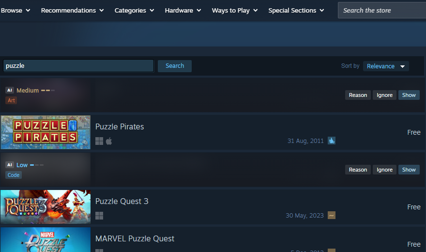
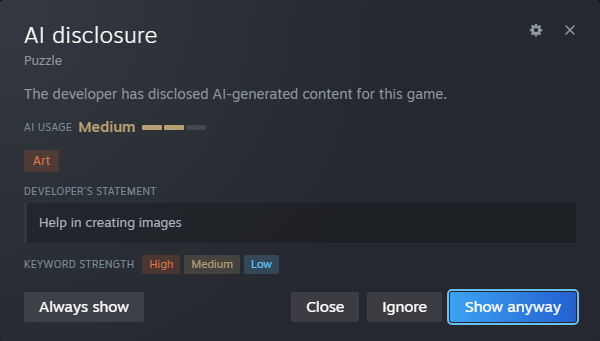
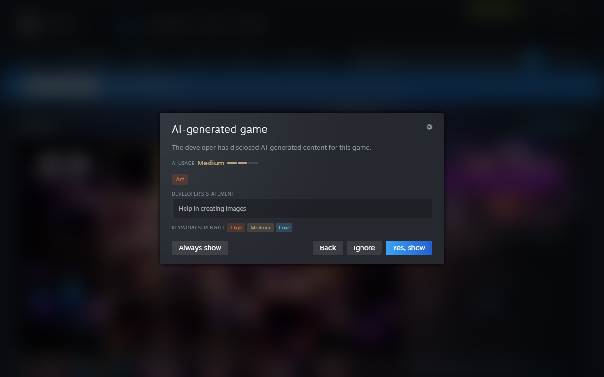
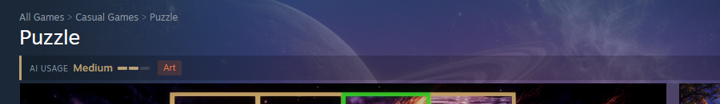
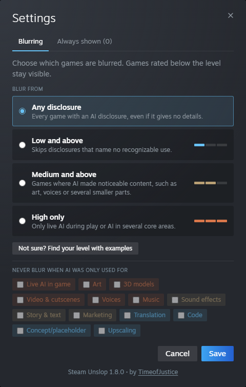

# Steam Unslop

Steam Unslop blurs games in the Steam store whose developers disclose AI-generated content. For
each game it rates how much AI was used and lists what it was used for, so you can decide
before you look.

It runs as a Chrome extension and as a [Millennium](https://steambrew.app) plugin for the Steam
desktop client. Both are only distributed through
[GitHub Releases](https://github.com/TimeofJustice/Steam-Unslop/releases); there is no store
listing.


## What it does

- **Blurs AI games everywhere in the store**: capsules, search results, list rows, the
  wishlist, the search suggestions, hover popovers, screenshots and trailers. Bundles are blurred
  when one of their games is.
- **Rates the AI use** as Low, Medium or High and tags it: art, 3D models, video, voices,
  music, sound effects, story and text, marketing, translation, code, concepts, and live AI
  that generates content while you play.
- **Explains the rating.** "Reason" shows the developer's own statement next to the rating.
  When the developer qualifies the use ("only as a starting point", "reworked by our team",
  "optional"), the rating is marked as uncertain and usually lowered one step.
- **Asks before showing a game page** of an AI game.
- **Lets you choose the threshold.** "Blur from" decides which games are blurred: any
  disclosure (the default), Low and above, Medium and above, or High only. Games below the
  threshold stay visible; their game page only shows the rating below the title.
- **Lets you act**: show a game anyway, or put it on Steam's ignore list. On your own wishlist,
  ignoring also removes the game from the wishlist, after a second click to confirm.
- **Warns before paying** when the cart holds AI games, with their ratings; you can go back or
  continue.
- **Helps report undisclosed AI.** Game pages without a disclosure show "Report AI slop", which
  opens Steam's own report dialog. Steam has no report reason for AI, so you choose the reason
  and describe what you noticed.

| Search results                                                  | Reason dialog                                                               |
| --------------------------------------------------------------- | --------------------------------------------------------------------------- |
|  |  |

| Game page                                                             | After confirming                                          |
| --------------------------------------------------------------------- | --------------------------------------------------------- |
|  |  |

The interface follows the Steam language. English is the default; German is included.

## Settings



The settings open with the Steam Unslop button next to the store search and with the gear
button at the top of every Steam Unslop dialog, in Chrome and in the Steam client alike. On the
first start a short tutorial explains the basics and ends with this choice. Not sure which level
to pick? "Find your level with examples" shows eight typical disclosures, asks for each whether
it should be blurred, and suggests the level that matches your answers; you can keep it or
choose yourself.

Two exceptions are set in the same dialog: kinds of use that alone never blur a game (for example
only translation or code), and games you always want to see, added with "Always show" in a
game's dialog and listed with a search in their own tab. The level can also be set in the popup of the Chrome extension and in the
Millennium settings. A change applies at once, in all open store tabs and windows.

## Installation

### Chrome (and other Chromium browsers)

Works in Chrome and Chromium-based browsers such as Edge and Brave.

1. Download `steam-unslop-chrome-<version>.zip` from the
   [latest release](https://github.com/TimeofJustice/Steam-Unslop/releases/latest).
2. Extract it to a folder you keep, for example `Documents/steam-unslop`. The browser loads the
   extension from this folder, so do not delete it.
3. Open `chrome://extensions` (in Edge: `edge://extensions`).
4. Turn on **Developer mode**.
5. Click **Load unpacked** and select the extracted folder (the one with `manifest.json`).
6. Open [store.steampowered.com](https://store.steampowered.com).

To update, extract the new release into the same folder, replacing the old files, and click the
reload button on the extension's card in `chrome://extensions`.

### Steam client with Millennium

1. Install [Millennium](https://steambrew.app) (version 3.4 or newer) and start Steam once.
2. Download `steam-unslop.star` from the
   [latest release](https://github.com/TimeofJustice/Steam-Unslop/releases/latest).
3. Copy it into the `millennium/plugins` folder inside your Steam installation, on Windows
   usually `C:\Program Files (x86)\Steam\millennium\plugins\`.
4. Restart Steam, enable **Steam Unslop** in the Millennium settings under Plugins and restart
   Steam again when asked.

To update, replace `steam-unslop.star` with the new file and restart Steam.

## How it works

Steam requires developers to fill in an "AI Generated Content Disclosure" on the store page.
Steam Unslop reads that section and nothing else; there is no list of games and no server.

1. **Finding games.** Every link to a game with a capsule image counts as a tile. When a tile
   comes near the viewport, the game's store page is fetched (four at a time, newest first,
   with a pause when Steam rate-limits). Until the answer arrives, the tile stays blurred, so AI
   art never flashes up. The whole page is needed: Steam's APIs such as `appdetails` do not
   include the disclosure.
2. **Reading the disclosure.** The statement is split into clauses. Negated clauses ("AI was
   not used for music"), hypothetical ones ("if you believe an artwork looks like AI") and pure
   statements about human work ("all art is made by our artists") are dropped. After a denial,
   an exception still counts as a use ("no AI except for the voices"). The rest is
   matched against keyword lists in English and German, plus Chinese, Japanese and Korean. The
   disclosure itself is found in every store language.
3. **Rating.** Each tag has a weight (art, voices or video weigh more than translation, code or
   upscaling). Live AI is always High. Qualifiers such as "starting point", "reworked", "upscaled"
   or "placeholder" lower the level one step and mark it as uncertain; live AI is never
   lowered. A disclosure without any recognizable keyword is rated Unclear.
4. **Blurring.** Images of the tile are blurred and an overlay shows the rating and the
   actions. Other media of the same game are blurred too: screenshots in the same card, hover
   popovers, and images or trailers elsewhere whose URL contains the game's app id.
5. **Caching.** Ratings are kept for 7 days (`chrome.storage` in the extension, `localStorage`
   in Millennium), plus a copy in `sessionStorage` so known games are blurred instantly on the
   next page. Statement texts are not stored; the dialog loads them again. Open store tabs share
   their results, so each game is fetched once, and a rate limit pauses all of them. Pages of
   mature games behind the age check are not rated until you passed it once. When an update
   improves the detection, cached games are rated again.

### Limits

- **Only disclosed AI is found.** Steam Unslop relies entirely on what developers declare. A game
  whose developer uses AI without saying so is not blurred, while honest developers are. A
  blurred game is therefore not worse than an unblurred one; it is only more open about it. The
  rating shows how much AI a game discloses, not how much it contains. If you notice AI content
  in a game without a disclosure, "Report AI slop" on its page lets you tell Valve.
- **The detection is keyword based and can be wrong**, especially with mixed or unusual
  phrasing. The dialog always shows the developer's own statement, so you can check. If you find
  a game that is rated wrong, please open an issue with the game's name and the text of its
  disclosure.

### Privacy

Steam Unslop only talks to `store.steampowered.com`: it loads store pages, and when you click
**Ignore** it calls the same endpoints as Steam's own ignore and wishlist buttons. Nothing is
sent anywhere else, and nothing is collected.

## Development

Requires Node.js 18 or newer. The Millennium plugin additionally needs [Bun](https://bun.sh).

```bash
npm install
npm test                # build and run the test suite (jsdom)
npm run test:visual     # layout checks in Chromium (needs `npx playwright install chromium`)
npm run format          # Prettier for all file types (format:check only checks)
npm run lint            # ESLint
npm run check           # license headers, ASCII-only code, matching versions and changelog
npm run build           # dist/core.js and the unpacked extension in dist/extension
npm run dev:millennium  # build the plugin and install it into the local Millennium
npm run release         # release/steam-unslop-chrome-<version>.zip and release/steam-unslop.star
npm run screenshots     # regenerate docs/images from the live store (Playwright)
```

For quick iteration in Chrome, run `npm run build` and load `dist/extension` as an unpacked
extension.

The screenshots show real store results. The search leaves out games with Steam tags for
mature or sensitive themes; to leave out more, copy
`scripts/screenshots-excluded.example.json` to `scripts/screenshots-excluded.json` (gitignored)
and add app ids or title words. A search term other than "puzzle" can be passed with
`npm run screenshots -- <term>`.

### Layout

```text
src/core/        shared logic as ES modules, bundled by esbuild from src/core/main.js
src/core/styles.css
src/locales/     translations for the UI, the extension metadata and the Millennium settings
src/data/        disclosure headings of all store languages, keywords for CJK statements
platforms/extension/   Chrome manifest, content script and icons
platforms/millennium/  Millennium plugin (webview preload and settings entry)
scripts/         build, release, screenshots, checks and data collection
test/            node:test suites running the built core in jsdom
test/fixtures/   local only: real disclosures with their reviewed rating (gitignored)
test/visual/     layout checks in Chromium
```

`src/core/main.js` holds the entry points: `hold()` runs at document start and keeps game
images blurred until they are checked, `start(storage)` begins scanning. Both wrappers in
`platforms/` only provide the storage adapter.

### Translations

Add `src/locales/<lang>.json` with the same keys as `en.json` and import it in
`src/core/i18n.js`; `steamLang()` there picks the language.

### Detection data

- `node scripts/collect-headings.mjs` fetches the disclosure heading in every store language
  into `src/data/ai-headings.json`.
- `node scripts/collect-disclosures.mjs [count]` collects real disclosures of recent releases into
  `test/fixtures/disclosures.json` for a local regression test. The file holds the developers'
  statements, so it is gitignored and the test is skipped without it. Review the ratings once;
  after a change to the detection, `--update` re-rates them and the diff shows what moved.

### Releasing

1. Set the new version in `package.json` and add a section for it to `CHANGELOG.md`. The build
   writes the version into the extension manifest and `millennium.toml`.
2. Commit, then push a tag with the same version: `git tag v1.6.0 && git push origin v1.6.0`.
3. The release workflow runs the tests and checks, builds both packages and publishes them as a
   GitHub release with the changelog section as release notes.

## License

Copyright 2026 Jonas Oelschner (TimeofJustice). Licensed under the [Apache License 2.0](LICENSE).

You may use, change and share Steam Unslop, also in your own projects. When you share it or
something based on it, keep the copyright notices in the files, include the [NOTICE](NOTICE)
file and the license, and mark the files you changed.
